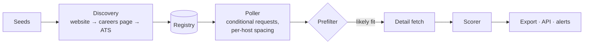

# JobAtlas

[](https://github.com/nathaniasSC2/JobAtlas/actions/workflows/tests.yml)

Finds jobs posted **directly on employers' own hiring systems** (the Greenhouse,
Lever, Ashby or Workday board a company runs itself, a university's PageUp feed,
a city's job RSS), scores each one against a profile, and serves the matches as
JSON, an HTTP API and Discord alerts. These are often jobs that reach LinkedIn
late or never.

Python 3.12, standard library only, SQLite.

## In production

I run it on my home server for my own job search. After ten days (2026-10-29):

| | |
|---|---|
| Employer boards tracked | **2,628** across 20+ hiring systems |
| Jobs seen | **132,825** (111,546 open) |
| Board requests answered `304 Not Modified` | **~75%** |
| Company names resolved to a verified board | ~26% |

## How it works



- **Discovery** goes from a company name to its website, careers page and ATS
  embeds, or tries slug guesses that are kept only when the board proves it
  belongs to that company. A bot wall or 429 counts as "can't tell", never "no board".
- **Polling** (`jobatlas watch`) runs continuously. Boards that have posted jobs
  in your fields are re-checked every 5–15 min when a re-check is a cheap `304`,
  the rest every 1–3 h, and a Strong match is sent the moment it's scored.
  A board's first poll is a baseline, so adding 500 boards doesn't flood "new".
  Only postings that pass a cheap title/location prefilter get their full text fetched.
- **Scoring** is rule-based and explainable (below).

## Scoring

The code reads the posting itself: the pay range in free text, years asked vs.
preferred, degree wording, remote/hybrid/on-site *as written* (not just the tag),
state hiring lists, weekend shifts, quota pay. What you want lives in a JSON
profile ([example](examples/profile.example.json)), and each hard rule can be
`skip`, `flag` or `ignore`. `jobatlas profile check` catches typos in it.

Every result says why:

```console
$ jobatlas check "IT Support Specialist I" --location "Raleigh, NC" --text-file posting.txt
  "score": 100, "tier": "strong",
  "reasons": ["NC is on its list of hiring states",
              "asks 2+ yrs; 4 credible in it support & administration",
              "pay up to $66k/yr", ...]

$ jobatlas check "Customer Onboarding Specialist" --location "Remote - US" --text-file other.txt
  "tier": "skip",
  "skips": ["says it can't hire in North Carolina",
            "required weekend work: 'Tuesday through Saturday'"]
```

## Supported hiring systems

| | |
|---|---|
| Polled via public JSON/RSS | Greenhouse, Lever, Ashby, Workable, Rippling, Workday, Oracle Recruiting, ADP, Recruitee, Teamtailor, BambooHR, Breezy, PageUp, Paylocity, Jobvite, CivicPlus, ApplicantPro |
| Opt-in | NEOGOV (its robots.txt only admits search engines) |
| Recorded, never polled | SmartRecruiters, Pinpoint (robots.txt disallows) |

An adapter is one module: `fetch`, `detail`, `public_url` and a `PARTIAL` flag
for boards that are searched rather than read in full.

## Polite by design

- Public endpoints only: nothing behind a login or CAPTCHA.
- robots.txt honoured for every host; one request at a time per host, and
  multi-tenant platforms share one gate.
- `If-None-Match` / `If-Modified-Since` whenever the board supports them.
- 429s back off and double the spacing; a long `Retry-After` is honoured across runs.

## Quick start

```bash
pip install .          # or run bin/jobatlas from the checkout
export JOBATLAS_DATA=$PWD/data
jobatlas init          # data dir + the example profile and employer list
jobatlas seed --sources employers,remoteintech
jobatlas discover-batch --budget 50
jobatlas poll          # one pass; `jobatlas watch` keeps going
jobatlas top --n 20
```

`jobatlas --help` lists the rest (`status`, `rescore`, `check`, `serve`…).
The API (`jobatlas serve`, read-only, binds to 127.0.0.1) serves `/latest.json`,
`/jobs/<id>`, `/status` and `/discover`. Alerts (Discord webhook or DM, or
iMessage) are configured in `config.json` with secrets in an env file
([example](examples/alerts.env.example)). `deploy/systemd/` has the `watch`
service and the API, plus poll and discovery timers if you'd rather run hourly.

Tests run offline against responses recorded from real boards:

```bash
python3 -m unittest discover -s tests
```

## Not in this repo

My own profile, seed lists and the integrations with my other tools. The example
profile is a made-up job seeker.

## License

MIT
