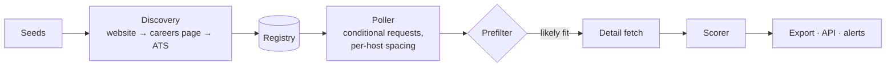

# JobAtlas

[](https://github.com/nathaniasSC2/JobAtlas/actions/workflows/tests.yml)

Finds jobs posted **directly on employers' own hiring systems** (the Greenhouse,
Lever, Ashby or Workday board a company runs itself, a university's PageUp feed,
a city's job RSS), scores each one against a profile, and serves the matches as
JSON, an HTTP API and Discord alerts. These are often jobs that reach LinkedIn
late or never.

Python 3.12, standard library only, SQLite.

## In production

I run it on my home server for my own job search. After ten days (2026-10-29):

| | |
|---|---|
| Employer boards tracked | **2,628** across 20+ hiring systems |
| Jobs seen | **132,825** (111,546 open) |
| Board requests answered `304 Not Modified` | **~75%** |
| Company names resolved to a verified board | ~26% |

## How it works



- **Discovery** goes from a company name to its website, careers page and ATS
  embeds, or tries slug guesses that are kept only when the board proves it
  belongs to that company. A bot wall or 429 counts as "can't tell", never "no board".
- **Polling** (`jobatlas watch`) runs continuously. Boards that have posted jobs
  in your fields are re-checked every 5–15 min when a re-check is a cheap `304`,
  the rest every 1–3 h, and a Strong match is sent the moment it's scored.
  A board's first poll is a baseline, so adding 500 boards doesn't flood "new".
  Only postings that pass a cheap title/location prefilter get their full text fetched.
- **Scoring** is rule-based and explainable (below).

## Scoring

The code reads the posting itself: the pay range in free text, years asked vs.
preferred, degree wording, remote/hybrid/on-site *as written* (not just the tag),
state hiring lists, weekend shifts, quota pay. It also reads the board's own country
for the job, Workday's telework tags ("No Telework" is on-site), and the application
form's questions: a remote job whose form asks you to live near an office elsewhere,
work on-site, or live in a list of states without yours is skipped, and so is one whose
form asks for work authorization only in another country. A clearance, a degree, a
driver's licence or weekend availability asked as a required yes/no question goes through
the same rule as in the posting, and so do your `required_gaps`. The employer's own
questions count toward the keyword match too. A posting up for
over 120 days is at most fair, and over a year it's skipped (`freshness` in the
profile; a job that newly appears on a board counts from then). What you want lives in a JSON
profile ([example](examples/profile.example.json)), and each hard rule can be
`skip`, `flag` or `ignore`. `jobatlas profile check` catches typos in it.

Every result says why:

```console
$ jobatlas check "IT Support Specialist I" --location "Raleigh, NC" --text-file posting.txt
  "score": 100, "tier": "strong",
  "reasons": ["NC is on its list of hiring states",
              "asks 2+ yrs; 4 credible in it support & administration",
              "pay up to $66k/yr", ...]

$ jobatlas check "Customer Onboarding Specialist" --location "Remote - US" --text-file other.txt
  "tier": "skip",
  "skips": ["says it can't hire in North Carolina",
            "required weekend work: 'Tuesday through Saturday'"]
```

A profile can also list `required_gaps` (things you don't have, e.g. a CPA or a
second language; they count only on the posting's *required* lines), a pay
`target_year`, and the leadership titles you're aiming for (`leadership.ok_titles`).

## Two job seekers, one crawl

`config.json` `"profiles"` adds more people (a household, say). Every job is
scored for each profile and goes to **one** of them, so two people never apply
to the same posting:

```json
"profiles": {"partner": {"file": "profile-partner.json", "claim_tier": "good",
                         "main_keeps_fields": ["tech_support"],
                         "ledger": {"path": "/srv/partner/seen.jsonl"},
                         "alerts": {"enabled": true, "channel": "discord_webhook", "style": "plain"}}}
```

- A job that is `good` or better for the partner is theirs, even if it also fits
  the main profile, except in `main_keeps_fields`, where it takes `strong`.
- Otherwise the main profile has first pick; jobs only the partner fits are theirs.
- A job that was already sent to someone stays with them.

Each profile has its own export (`export/latest-partner.json`, `jobatlas top
--profile partner`, `/latest.json?profile=partner`), ledger and alert settings.
An extra profile never inherits the main profile's alert recipient.
[Second example profile](examples/profile.partner.example.json).

### Head-to-head: who would get the interview?

Tier rules can't tell which of two people a recruiter would call back. With
`"duel"` in `config.json`, a job that is a match for both the main profile and a
partner (and that neither has seen yet) goes to a model instead: `jobatlas duel
run` (a timer, every few minutes) gives it the posting next to each person's
resumes and facts and asks it, as that employer's recruiter, for each one's
chance of a phone screen, the hard requirements each fails, the resume each
should send and a one-line reason, as strict JSON.

```json
"duel": {"enabled": true, "with": "partner", "favor": "partner", "margin": 0.10,
         "command": ["claude", "-p", "--model", "sonnet", "--output-format", "json", "--tools", ""],
         "candidates": {"main":    {"label": "Sam",  "resumes": {"Support": "sam-support.pdf", "Community": "sam-community.pdf"},
                                    "facts": ["No degree", "Remote or downtown only (doesn't drive)"]},
                        "partner": {"label": "Alex", "resumes": {"General": "alex.pdf"}, "facts_file": "alex-notes.md"}}}
```

- A hard gate only one of them fails (a required degree, years in a title, a
  technical requirement, the commute, pay under their floor) decides it.
- Otherwise the `favor` side gets the job unless the other's chance is at least
  `margin` higher (or, with `ratio` set, that many times higher, for long shots
  like 0.09 vs 0.03), so a near tie goes to `favor`.
- The model is told to count only the employer's requirements as gates, never
  a candidate's own preferences, and to ignore names, gender and age.
- Verdicts are stored with a hash of every input, so a job is judged again only
  when its posting, a resume or the facts change. Changing `margin` re-decides
  stored verdicts without new calls.
- New contested jobs wait up to `hold_minutes` for their verdict before alerts
  go out, so they reach the right person. If the model is down or out of quota,
  the tier rule decides, as before.
- Exports, `top` and alert texts carry the verdict from each side ("Better for
  you than for Sam: bachelor's degree required"). `jobatlas duel show` lists
  them; `enabled: false` records verdicts without routing by them (a dry run).
- Resumes can be PDF (read with `pdftotext`) or text. Email addresses and phone
  numbers are taken out before anything is sent to the model.

## Supported hiring systems

| | |
|---|---|
| Polled via public JSON/RSS | Greenhouse, Lever, Ashby, Workable, Rippling, Workday, Oracle Recruiting, ADP, Recruitee, Teamtailor, BambooHR, Breezy, PageUp, Paylocity, Jobvite, CivicPlus, ApplicantPro |
| Opt-in | NEOGOV (its robots.txt only admits search engines) |
| Recorded, never polled | SmartRecruiters, Pinpoint (robots.txt disallows) |

An adapter is one module: `fetch`, `detail`, `public_url` and a `PARTIAL` flag
for boards that are searched rather than read in full.

## Polite by design

- Public endpoints only: nothing behind a login or CAPTCHA.
- robots.txt honoured for every host; one request at a time per host, and
  multi-tenant platforms share one gate.
- Forms that only exist in a browser (Ashby's, Workday's apply page) are read with
  an optional browser server (`forms.browser`, [camofox-browser](https://github.com/jo-inc/camofox-browser)):
  the public page is loaded if robots.txt allows it, read, and the tab closed, one
  at a time. Nothing is typed or submitted and no account is made, so Workday's
  questions, which come after Create Account or the first steps, are recorded as
  not readable.
- `If-None-Match` / `If-Modified-Since` whenever the board supports them.
- 429s back off and double the spacing; a long `Retry-After` is honoured across runs.

## Quick start

```bash
pip install .          # or run bin/jobatlas from the checkout
export JOBATLAS_DATA=$PWD/data
jobatlas init          # data dir + the example profile and employer list
jobatlas seed --sources employers,remoteintech
jobatlas discover-batch --budget 50
jobatlas poll          # one pass; `jobatlas watch` keeps going
jobatlas top --n 20
```

`jobatlas --help` lists the rest (`status`, `rescore`, `check`, `serve`…).
The API (`jobatlas serve`, read-only, binds to 127.0.0.1) serves `/latest.json`,
`/jobs/<id>`, `/status` and `/discover`. Alerts (a Discord webhook, DM or server
channel, or iMessage) are configured in `config.json` with secrets in an env file
([example](examples/alerts.env.example)); `jobatlas alerts test` checks the setup.
With `"style": "card", "form": true` each job gets a line on its application form:
the written answers it needs (quoted), "quick apply", or "not read" for boards whose
forms aren't public. Greenhouse, Rippling and NEOGOV forms come with the job's
detail. Lever's (its `/apply` page), Workable's (`/api/v1/jobs/<code>/form`), Ashby's
and Workday's (in the browser) are read for every scored job: a new match's form
before its alert, within `forms.new_seconds`; one that isn't read in time is alerted
as "form not read yet" and read after the alerts, with older jobs. `jobatlas forms`
counts them by state, and `jobatlas forms --read N` reads some now. `jobatlas alerts catchup --hours 336` sends the backlog once
after you turn alerts on. `deploy/systemd/` has the `watch`
service and the API, plus poll and discovery timers if you'd rather run hourly.

Tests run offline against responses recorded from real boards:

```bash
python3 -m unittest discover -s tests
```

## Not in this repo

My own profile, seed lists and the integrations with my other tools. The example
profile is a made-up job seeker.

## License

MIT
